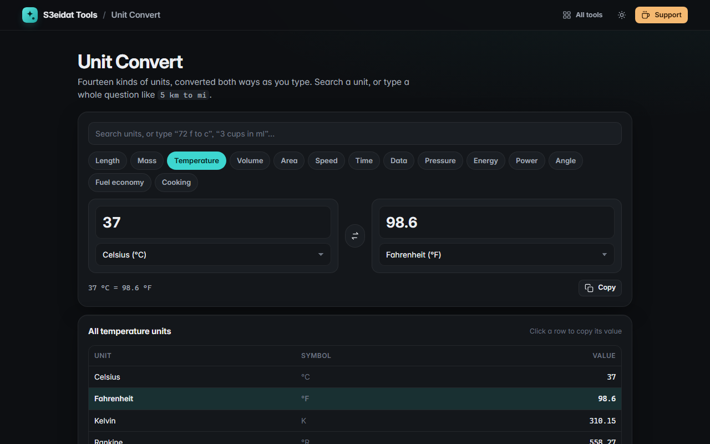

# Unit Convert

> Length, weight, temperature, data and ten more kinds of units, converted both ways as you type. Free, private, and it runs entirely in your browser.

### ▶ [Open Unit Convert](https://s3eidat.github.io/unit-convert/)



## Features

- **14 categories**: length, mass, temperature, volume, area (incl. dunam), speed, time, data, pressure, energy, power, angle, fuel economy and cooking
- **Two-way live conversion**: type on either side; **swap** units in one click
- **All-units table** for the current value; click any row to copy it
- **Search** any unit by name or symbol, or type a whole question like `5 km to mi` or `72 f in c`
- **Data** in both SI (kB, MB, GB) and binary (KiB, MiB, GiB) units, plus bits
- **Fuel economy** handles the inverse L/100 km scale; **temperature** handles offsets (°C, °F, K, °R)
- Exact defining factors (1 in = 2.54 cm, 1 lb = 0.45359237 kg); results shown to 10 significant digits

Cooking conversions are by volume only; turning cups into grams needs the ingredient's density.

## Privacy

Your numbers never leave your device. There is no server, no account, no analytics.
The page ships with a strict Content-Security-Policy (`connect-src 'self'`), so the browser
itself blocks any attempt to send data anywhere.

## Run it yourself

It's plain HTML, CSS and JavaScript with no build step:

```bash
git clone https://github.com/s3eidat/unit-convert
cd unit-convert
python -m http.server 8000
```

Then open http://localhost:8000.

## Support

If this saved you time, **[buy me a coffee ☕](https://s3eidat.github.io/coffee/)**. It keeps every tool free.

---

Part of **[S3eidat Tools](https://s3eidat.github.io/)**: 100+ free, private tools that run in your browser. MIT licensed.
